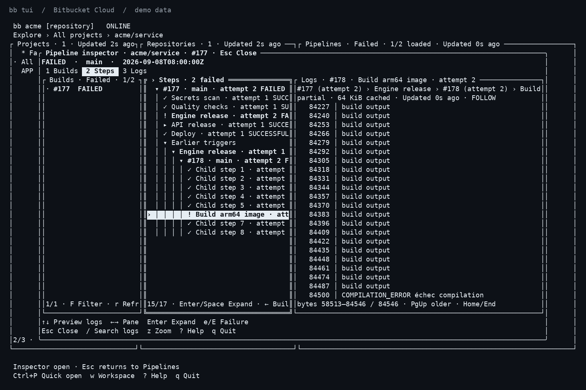

# bb

[](https://github.com/ledubenjamin/bb-cli/actions/workflows/ci.yml)
[](LICENSE)

**Bitbucket Cloud from your terminal, scripts, and coding agents.**

Review pull requests, inspect pipelines and logs, and manage repositories with one Rust CLI. Use the terminal explorer interactively, or select stable JSON fields and discover command schemas offline.

```sh
bb pr list -R acme/widgets --json number,title,headRefName
bb pr view 42 -R acme/widgets --json number,body,files,comments,checks
bb tui -R acme/widgets
```

`bb` targets Bitbucket **Cloud**. It does not support Bitbucket Server/Data Center and is not affiliated with Atlassian.

## Install

Prebuilt archives require no Rust toolchain. The release matrix covers Linux x86_64/ARM64 and Windows x86_64, with explicit Ubuntu 24.04 and 26.04 checks.

**Development branch:** Windows binaries and `bb skills` will ship in the next release. Published v0.1.2 archives contain Linux binaries only.

On Linux:

```sh
curl -fsSL https://github.com/ledubenjamin/bb-cli/releases/latest/download/install.sh | sh
export PATH="$HOME/.local/bin:$PATH"
bb --version
```

On Windows, download and inspect the PowerShell installer before running it:

```powershell
Invoke-WebRequest https://github.com/ledubenjamin/bb-cli/releases/latest/download/install.ps1 -OutFile install-bb.ps1
Get-Content .\install-bb.ps1
.\install-bb.ps1
```

Re-run the installer to update. Downloads are checksum-verified; failed verification preserves the installed binary. See [installation](docs/installation.md) for prerequisites, private-repository downloads, manual archives, version selection, and building from source. Git is needed for clone, checkout, rebase, and remote detection.

## Get started

```sh
# Interactive login stores the token in your operating system keyring.
bb auth login --profile work
bb auth status

# Explicit repository selection works from any directory.
bb pr list -R acme/widgets
bb run list -R acme/widgets
bb run view 42 -R acme/widgets --log --step Build
```

For CI and agents, inject `BB_TOKEN` through your secret manager. Credentials never fall back to plaintext storage. [Authentication and context selection](docs/usage.md#authenticate) cover token types, required scopes, multiple accounts, and browser login.

## Teach your coding agent to use bb

Install the official skill from the same binary, without a network request:

```sh
# Run from your project root; choose the agent you use.
bb skills install --agent codex
bb skills install --agent claude

# Inspect instructions and installation state.
bb skills show
bb skills status --agent codex --json '*'
```

The skill teaches command discovery, explicit repository selection, JSON output, dry runs, and how to handle uncertain writes. Re-running installation updates an intact official skill; local edits are preserved and reported as conflicts. Use `--scope user` to install for your account. See the [skills guide](docs/skills.md) for paths, updates, and removal.

## Interactive terminal and automation

`bb tui` explores workspaces, projects, repositories, pipeline trees, and cached logs. Press `?` for keyboard help. `bb tui --offline` uses cached data, and `bb logs search` searches downloaded log portions without HTTP requests. See the [terminal guide](docs/terminal.md).



Terminal rendering from the integration-test fixtures; all repository and log data is synthetic.

For automation, use ordinary commands with JSON:

```sh
bb schema pr create
bb pr list --json                       # Lists fields without executing
bb pr list -R acme/widgets --json number,title
bb pr create -R acme/widgets --head feature/checks --base main \
  --title "Improve checks" --body-file description.md --dry-run --json '*'
```

Results go to stdout and diagnostics to stderr. Bare `--json` discovers fields; `--json '*'` executes. `--dry-run` previews writes and may perform reads to resolve IDs. Command schemas document arguments, effects, scopes, and output. The [agent contract](docs/agents.md) explains exit codes, errors, filtering, pagination, and mutation boundaries.

## Documentation and development

| Guide | Contents |
| --- | --- |
| [Installation](docs/installation.md) | Linux/Windows, updates, archives, source builds |
| [Usage](docs/usage.md) | Authentication, contexts, commands, JSON, REST |
| [Terminal](docs/terminal.md) | Navigation, pipeline states, log cache, offline use |
| [Agent skills](docs/skills.md) | Codex/Claude Code installation and lifecycle |
| [Agent contract](docs/agents.md) | Machine-readable behavior and failure handling |
| [Development](docs/development.md) | Rust conventions, tests, platform checks |
| [Releases](docs/releasing.md) | Packaging, publication, public-repository preparation |
| [Parity](docs/parity.md) and [design](docs/design.md) | Supported workflows and architecture |

The workspace contains `bb-api`, an asynchronous library, and `bb-cli`, the `bb` executable. Rust 1.99.0 is pinned for development. See [CONTRIBUTING.md](CONTRIBUTING.md) and the library's [examples](https://github.com/ledubenjamin/bb-cli/tree/master/crates/bb-api/examples).

MIT licensed. The reference Go client is credited in [NOTICE](NOTICE). Report vulnerabilities using [SECURITY.md](SECURITY.md); release changes are tracked in [CHANGELOG.md](CHANGELOG.md).
